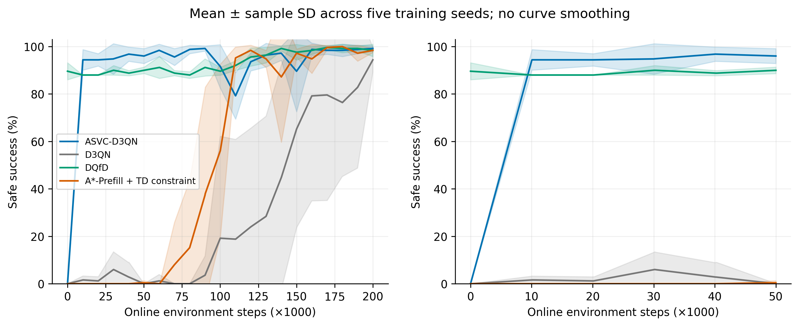
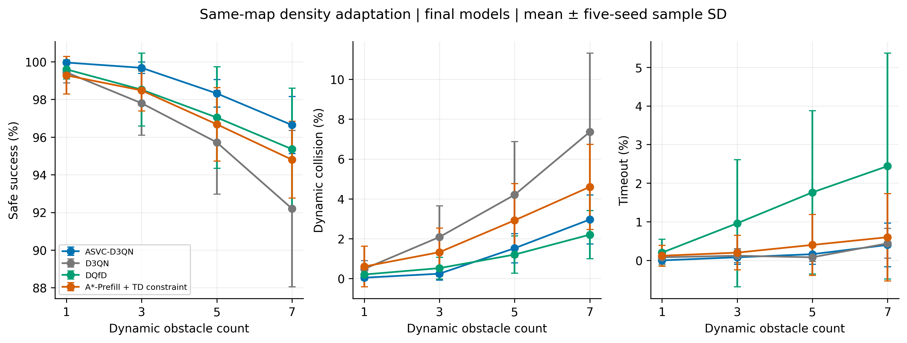

# ASVC-D3QN：初始化机制对照与动态障碍密度测试

本批已于2026-10-16完成。[阅读包](../results/analysis_upload/asvc_paper_supplement_v1/LATEST.md)包含实际结果、图表、原始CSV、逐seed配对差、冻结场景、源码快照及SHA清单。ASVC-D3QN是已有`advice_bound_margin_all_eligible`的论文显示名称；历史方法ID、配置、结果路径不变。

## 完成范围

- 仅新增`astar_prefill_bound`的seed0–4，共5次200000在线步训练，每次199501次更新、0次离线更新。其余模型直接复用最终200000步权重。
- 7260条冻结DQfD训练示范全部按真实环境逐条重放核对，包含198次基于观测风险的等待。一次性初始化10000容量均匀FIFO回放，允许覆盖；没有在线A*代选、动作监督、PER或永久示范分区。初始化不使更新早于第500在线步。
- 原50场景学习曲线及原冻结500最终评估协议保持一致；新增5个模型的原500评估全部完成。
- 同地图1、3、5、7动态障碍，每档500个新冻结场景，四方法各五seed，共80组密度评估。加上原500共85组、42500条场景记录。
- 全部自主评估ε=0，关闭教师、路线引导、动态安全屏蔽和Q输出裁剪，保留共同静态合法动作掩码。仅评估最终模型，不选最佳检查点。

这是**A*初始化机制对照**，不是A*-IDDQN原论文完整复现。密度实验是同地图适应测试，不用于调参，不作跨地图泛化结论。

## 实际结果

均值±样本标准差，统计单位为五个训练seed，百分比单位。

|方法|0–20万步AULC|原500安全成功率|7障碍安全成功率|7障碍动态碰撞率|7障碍超时率|
|---|---:|---:|---:|---:|---:|
|ASVC-D3QN|92.99±1.36|99.36±0.43|96.64±1.52|2.96±1.23|0.40±0.57|
|原始D3QN|29.08±17.45|97.48±1.68|92.20±4.15|7.36±3.95|0.44±0.38|
|DQfD|93.24±0.42|97.88±2.09|95.36±3.24|2.20±1.21|2.44±2.92|
|A*初始化＋TD约束|51.51±6.16|96.84±2.03|94.80±2.03|4.60±2.14|0.60±1.13|

ASVC相对初始化对照，全程AULC的同seed配对差为41.48±5.27个百分点，原500成功率配对差为2.52±1.70个百分点。不能据此主张所有指标全面最优：DQfD全程AULC均值略高，7障碍动态碰撞率均值更低，但有20000次额外离线更新、永久示范与PER。全部密度及逐seed差异见包内CSV。

AULC按实际验证步数积分；曲线阴影为五seed样本标准差，绘图仅线性对齐验证时间，不平滑。历史未记录的耗时、设备及A*成本字段留空。新增训练使用RTX 4060 Laptop GPU；示范原始生成成本与每seed初始化开销分别记录。

## 图表与审计入口

[固定版本阅读入口](../results/analysis_upload/asvc_paper_supplement_v1/20261016_023138_369676/README.md) · [主表](../results/analysis_upload/asvc_paper_supplement_v1/20261016_023138_369676/paper/main_results.md) · [模块消融表](../results/analysis_upload/asvc_paper_supplement_v1/20261016_023138_369676/paper/module_ablation.md)





包内paper目录包含环境图、框架图、全程及前5万步学习曲线、两张结果表、配对增益点图、密度三联图和三个预注册场景的轨迹图，均有PDF、SVG及300dpi PNG。CSV、代表性完整轨迹JSON及绘图脚本一并保留。

密度v1出现12处障碍初始位置重叠，已保留为历史。正式密度v2只按环境合法性修正相位，全部2000场景通过构造与重置检查；严格嵌套，路线类别总数之差最多为1。生成规则、两版记录和SHA均保留，正式统计只使用v2。

## 上传范围与命令

在仓库根目录执行以下预览（不改索引）：

```powershell
powershell -NoProfile -ExecutionPolicy Bypass -File .\scripts\sync_github.ps1 -AsvcOnly -Preview
```

预览和上传均先核对SHA、五次完整训练、85组评估及逐场景汇总。上传包含本批源码、配置、冻结数据、文档和唯一阅读包，约112 MiB；最大单文件约2.73 MiB。权重、恢复断点、全量原始轨迹和重复实时结果保留本地。范围外历史轨迹修改不进入本批提交；已有范围外暂存内容时脚本停止，不清理用户工作。

保持此前Clash代理开启，提交并推送到`origin/main`：

```powershell
powershell -NoProfile -ExecutionPolicy Bypass -File .\scripts\sync_github.ps1 -AsvcOnly -ProxyUrl http://127.0.0.1:7897
```

不用代理时省略`-ProxyUrl`。本次整理不执行提交或推送。校验现成阅读包不需要权重、GPU或重新训练：

```powershell
python scripts/verify_asvc_upload.py
```

## 复现与本地结果

训练与恢复入口`python scripts/run_asvc_supplement.py --train`及`--train --resume`仅供需要重新实验或恢复时使用，本批已经完成，不应为上传再次运行。`python scripts/evaluate_asvc_supplement.py`要求本地已有最终权重，缺权重不会自动重训。`python scripts/plot_asvc_supplement.py`从本地原始结果重新绘图；直接克隆后可先阅读包内现成图表、CSV和源码。

- 新模型及完整轨迹：`outputs/asvc_paper_supplement_v1/`（本地）。
- 实时结果和重复图表：`results/asvc_paper_supplement_v1/`（本地）。
- 训练登记：`data/asvc_paper_supplement_v1/`。
- 正式密度场景：`data/asvc_paper_density_v2/`。
- GitHub阅读入口：`results/analysis_upload/asvc_paper_supplement_v1/LATEST.md`。
