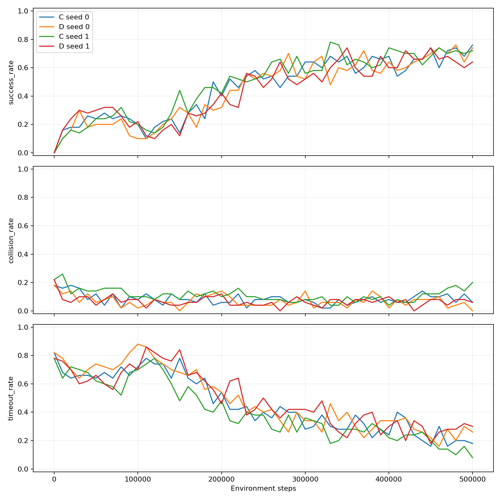

# 同地图多起终点与风险自适应监督预实验

2026-10-26 06:19，四次运行全部完成，每次 500000 环境步、499501 次更新，无失败记录。C 为持续弱监督 ASVC，D 仅对合格监督样本增加四步风险软权重。两个测试池和 A～F 正式消融均未运行。

## 结果

| 方法 | seed | 最终成功率 | 碰撞率 | 超时率 | 全程 AULC |
|---|---:|---:|---:|---:|---:|
| C 持续弱监督 | 0 | 76% | 6% | 18% | 45.88% |
| D 风险自适应 | 0 | 74% | 0% | 26% | 44.22% |
| C 持续弱监督 | 1 | 72% | 20% | 8% | 48.40% |
| D 风险自适应 | 1 | 64% | 6% | 30% | 44.12% |

C/D 两 seed 最终平均成功率为 74%/69%，碰撞率为 13%/3%，超时率为 13%/28%。成功率从初始 0% 提升到 64%–76%，说明多任务学习有进展；四次均未达到预登记描述性门槛（总体至少 80%，每档至少 70%）。

全程 AULC 是按环境步积分后的曲线平均成功率，C/D 为 47.14%/44.17%。D−C 全程差在 seed 0、1 分别为 −1.66、−4.28 个百分点，学习速度没有一致增益。后半程最低成功率为 C 46%、54%，D 48%、46%，稳定性也没有一致改善。

四次中三次在最后 10 万步仍有净提升，50 万步预算的充分性尚未得到支持，延长训练的收益仍未知。D 的累计监督系数约为其未降权基准的 67%；不能把超时增加直接归因于监督减少。

统计单位是训练 seed，只有两个。51 次验证反复使用同一组 50 个场景，10200 条记录不是独立测试任务，也不能视为 10200 次训练重复。未见组合和未见目标测试池未评估，不能宣称未见目标泛化或正式显著性结论。

## 文件导航

- [逐次结果](summary/run_results.csv)、[两 seed 均值及样本标准差](summary/group_means_sample_sd.csv)、[配对差](summary/paired_D_minus_C_per_seed.csv)。
- [原始汇总](summary/REPORT.json)、[全部 204 个验证点](summary/validation_curves_all_seeds.csv)、[逐检查点配对差](summary/paired_D_minus_C_curves.csv)。
- [分风险监督](summary/supervision_by_risk.csv)、[回放/代选/Q 值诊断](summary/diagnostics_per_seed.csv)。
- [长度分档曲线](figures/length_band_learning_curves.png)、[同 seed 差异图](figures/paired_differences.png)。
- `run_logs/C/seed_0` 等四个目录：完成标记、运行身份、2550 条验证明细、训练回合、实际回放更新、离线案例和控制台日志。
- [冻结协议](registration/frozen_protocol.json)、[任务池](inputs/task_pools.json)、[50 个验证场景](inputs/validation_scenes.json)、[训练序列预览](inputs/training_sequence_preview.json)。
- `source_snapshot/` 为训练时配置、源码和测试的冻结字节；`formal_reserved/` 的六组配置仅预留，不可通过本轮入口启动。
- [模型索引](model_index.csv)记录四个最终模型及完整断点的本地路径和 SHA，文件本体保留本地。
- [检查记录](checks/preflight_checks.log)、[实际 CUDA batch64 一致性](checks/production_cuda_checks.json)、[本地启动和续跑说明](RUN_GUIDE.zh-CN.txt)。
- `manifest.json` 包含完整文件 SHA；`upload_scope.json` 限定本批 Git 提交范围。

## 实验边界

使用原静态地图、网络、奖励、gamma、五动作、碰撞规则、Smooth L1 和梯度裁剪。C/D 均使用 TD 目标 [-6,10]、相同硬标签筛查、代选及基础监督日程。D 仅增加 `(1-R)^2`，H=4、gamma_r=0.9、d_crit=0、d_safe=2，风险从局部观测关联估计，不读取隐藏未来。风险不是碰撞概率或安全保证。

每条经验记录自己的任务，BFS 动作场按地图/目标缓存并以位置索引；历史动态通道只保留当时实际可见的观测。训练池 240 对，验证池 50 对，两个测试池各 60 对；候选目标 50 个中 10 个用于未见目标测试。短/中/长任务等比例，超时 max(100,4×最短路长度+20)，超时保留 TD 自举。

所有监督统计来自实际回放更新。环境标签可用率为行动前硬门控，回放覆盖率另含碰撞经验的监督筛除。碰撞经验仍参与 TD。案例中的教师动作、风险及权重在验证全部结束后离线计算，不参与决策。

## 校验和复现

仓库根目录执行 `python scripts/package_multitask_evidence.py --verify`。只需标准库，无需模型、PyTorch 或原始 outputs；命令校验 SHA、四次预算、10200 条验证记录、学习曲线积分、均值/样本标准差及同 seed 差异。

原工作空间可加 `--check-sources` 校验原始文件及模型/断点。训练入口保持原有严格冻结和历史保护，完整续训需要本地完整检查点；克隆后的阅读包校验不代表已具备全部训练恢复文件。不要修改冻结协议以绕过检查。

本包整理没有新增训练、模型评估、测试池访问或 Git 推送。旧实验和旧模型保持原样。上传命令见仓库 `docs/ASVC_MULTITASK_PILOT.zh-CN.md` 和 `docs/GITHUB_SYNC.zh-CN.md`。
