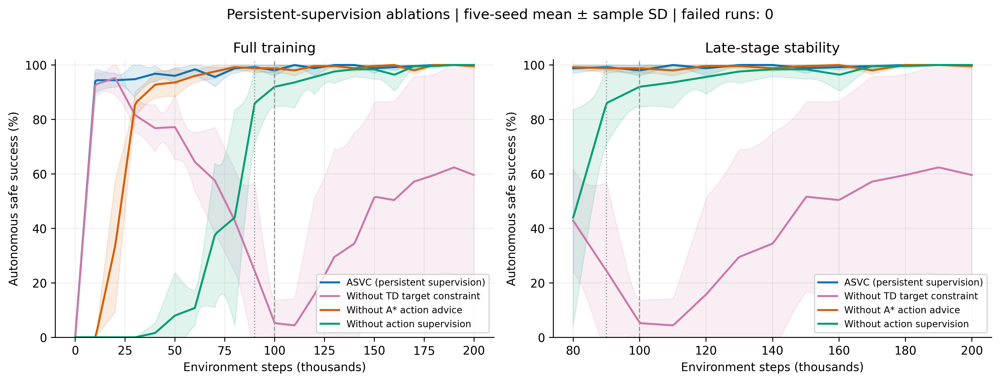
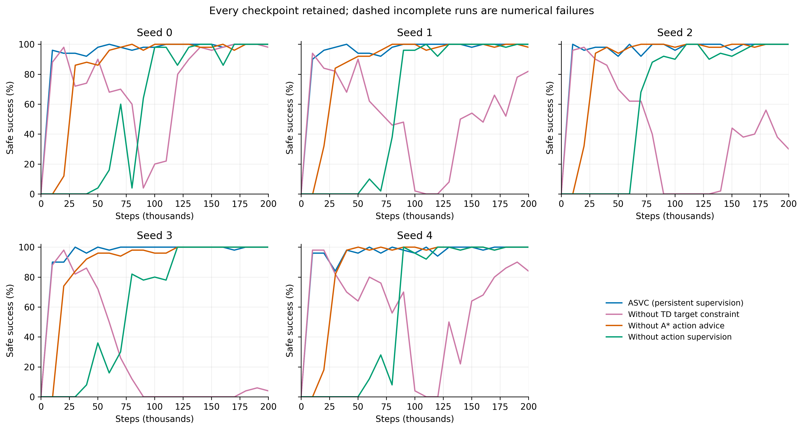
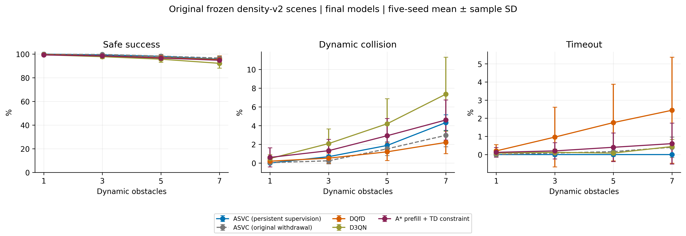

# 持续弱监督新版：模块消融与障碍密度测试

监督从1下降到0.1后持续保留；完整方法A*代选在10万步退出。去TD仅取消TD目标裁剪；去代选保留监督标签和0.1权重。奖励、观测、网络、风险筛选和训练预算沿用完整方法。

只新增两个消融×五seed训练，各20万步；完整方法和去监督对照复用已核对结果。最终评估均为网络自主行动，只有静态非法动作屏蔽，不使用A*、教师、未来障碍信息或动态安全屏蔽。

## 新版模块消融

|方法|全程AULC|后半程AULC|后半程最低成功率|最终500成功率|
|---|---:|---:|---:|---:|
|新版完整方法|95.63±0.38%|99.54±0.34%|96.80±1.79%|99.28±0.73%|
|新版去TD目标约束|50.65±17.98%|39.73±31.00%|4.00±8.94%|61.24±38.08%|
|新版去A*动作代选|86.93±1.38%|99.28±0.13%|96.80±1.10%|98.72±0.39%|
|去动作监督（复用）|60.44±2.30%|97.52±1.08%|87.60±5.90%|98.92±1.32%|

## 新版障碍密度测试

|方法|1个障碍|3个障碍|5个障碍|7个障碍|
|---|---:|---:|---:|---:|
|新版完整方法|100.00±0.00%|99.32±0.18%|98.12±0.39%|95.68±0.83%|
|原版ASVC（复用）|99.96±0.09%|99.68±0.30%|98.32±0.73%|96.64±1.52%|
|DQfD（复用）|99.60±0.51%|98.52±1.94%|97.04±2.70%|95.36±3.24%|
|D3QN（复用）|99.44±0.55%|97.80±1.70%|95.72±2.76%|92.20±4.15%|
|A*初始化＋TD约束（复用）|99.28±1.00%|98.48±1.10%|96.68±1.95%|94.80±2.03%|

每档500个原冻结v2场景，新版5模型×4档共新增10000回合，四个旧对照的40000回合核对后复用。

所有均值±样本标准差以训练seed为单位。AULC按实际步数积分；曲线只对齐时间点，不平滑、不选择最好检查点。最低值先按每个seed计算再平均。

这是固定地图及既定动态障碍分布的测试，不是跨地图泛化。DQfD另外使用2万次离线更新、永久示范和PER；同在线步数不等于同总计算预算。

新旧完整方法五seed对比和新版最终500结果继续保留；本报告没有重跑它们。旧消融和旧密度结果保留原版本标签。所有图提供PNG、PDF和SVG。
