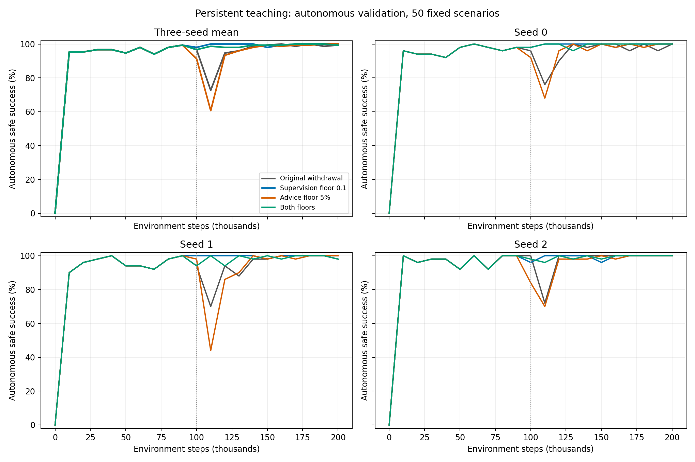

# 持续指导实验：三种子结果

四组均为20万环境步；新增9次训练，复用原方案3次。评估关闭A*代选，使用固定50验证场景。奖励保持原版。

监督权重下限0.1（9万步起），代选概率下限0.05（93750步起）；保持原观测风险筛选与TD目标约束。

下表为3个训练种子的均值；最低成功率先逐种子取检查点最低值再平均。AULC为按训练步数平均的曲线面积，不是独立场景成功率。

|方案|9–12万最低成功率|10–20万最低成功率|10–20万AULC|最终成功率|最终超时率|
|---|---:|---:|---:|---:|---:|
|原方案|72.67%|72.67%|95.67%|99.33%|0.00%|
|持续弱监督|98.00%|97.33%|99.63%|100.00%|0.00%|
|持续少量代选|60.67%|60.67%|94.04%|100.00%|0.00%|
|两者都保留|96.00%|95.33%|99.06%|99.33%|0.00%|

## 配对差值（新方案减原方案，百分点）

|方案|种子|原退化窗口最低值变化|10–20万最低值变化|10–20万AULC变化|最终成功率变化|
|---|---:|---:|---:|---:|---:|
|持续弱监督|0|+22.00|+22.00|+4.29|+0.00|
|持续弱监督|1|+30.00|+28.00|+5.40|+2.00|
|持续弱监督|2|+24.00|+24.00|+2.18|+0.00|
|持续少量代选|0|-8.00|-8.00|-0.21|+0.00|
|持续少量代选|1|-26.00|-26.00|-2.87|+2.00|
|持续少量代选|2|-2.00|-2.00|-1.83|+0.00|
|两者都保留|0|+22.00|+20.00|+4.09|+0.00|
|两者都保留|1|+24.00|+24.00|+4.19|+0.00|
|两者都保留|2|+24.00|+24.00|+1.88|+0.00|

证据范围：3个种子、固定地图及起终点、已使用过的50验证场景；未使用独立500测试集，不宣称跨地图泛化或统计显著性。
保留全部种子及全部检查点，不能仅根据最终成功率判定退化消失。指导比例不根据本批结果改动。
数值、配对差、指导日程核查及训练前段逐参数一致性分别见同目录CSV；原始来源SHA见evidence.json。

## 逐种子改善情况

- 持续弱监督：3/3个种子的原退化窗口最低值提高；3/3个种子的后半程AULC提高；0/3个种子的后半程最低值降低。
- 持续少量代选：0/3个种子的原退化窗口最低值提高；0/3个种子的后半程AULC提高；3/3个种子的后半程最低值降低。
- 两者都保留：3/3个种子的原退化窗口最低值提高；3/3个种子的后半程AULC提高；0/3个种子的后半程最低值降低。

这些是配对描述统计。只有后半程曲线也支持改善，才不能简单解释为低谷后移；3个种子与离散检查点仍不足以证明退化永久消失。
