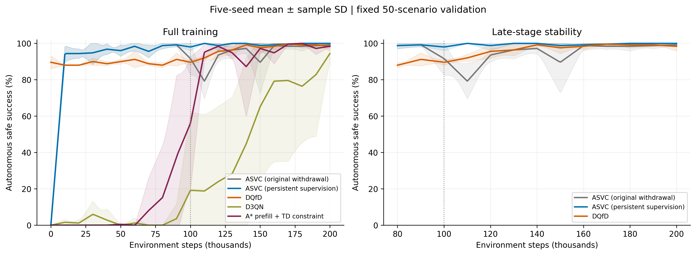
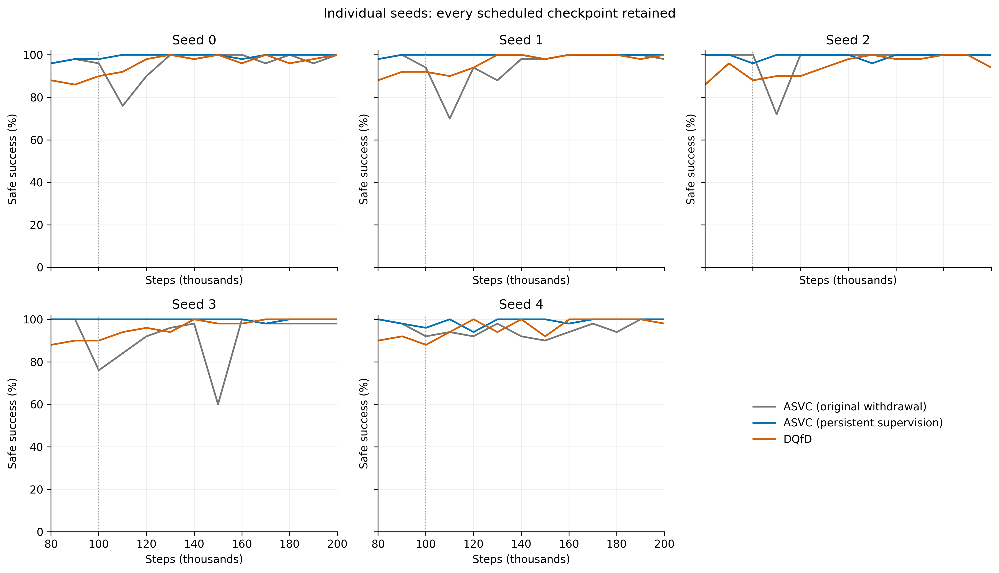

# 持续弱监督：五个seed复核与主结果图

复用seed0–2，只新增seed3、4。各20万环境步；监督权重下限0.1，A*代选在10万步退出。评估由网络独立行动。

前三个seed参与了方法选择，后两个seed用于复核；合并五seed不是五个全新、盲选的重复实验。

|方法|全程AULC|后半程AULC|后半程最低成功率|最终500安全成功率|
|---|---:|---:|---:|---:|
|原ASVC|92.99±1.36%|94.58±2.23%|73.60±10.90%|99.36±0.43%|
|持续弱监督ASVC|95.63±0.38%|99.54±0.34%|96.80±1.79%|99.28±0.73%|
|DQfD|93.24±0.42%|97.11±0.69%|89.20±1.10%|97.88±2.09%|
|D3QN|29.08±17.45%|55.57±32.21%|18.80±42.04%|97.48±1.68%|
|A*初始化＋TD约束|51.51±6.16%|94.14±3.55%|50.00±36.11%|96.84±2.03%|

各指标均为五seed均值±样本标准差；先逐seed取后半程最低点，再平均。最终500成绩与固定50验证曲线分开报告。

## 新版相对原版的同seed差值（百分点）

|seed|后半程AULC变化|后半程最低值变化|最终500成功率变化|
|---|---:|---:|---:|
|0|+4.29|+22.00|-0.40|
|1|+5.40|+28.00|-0.60|
|2|+2.18|+24.00|-0.40|
|3|+8.72|+38.00|+0.80|
|4|+4.20|+4.00|+0.20|

## 采用判定

通过预先登记的描述性门槛，建议采用持续弱监督作为当前主方法。

门槛为新增两个seed的后半程AULC和最低值均不降低、五seed平均两项均提高，且最终500平均成功率下降不超过1个百分点。这个容许幅度用于工程选择，不是显著性检验。

- both_new_seeds_late_aulc_not_lower: True
- both_new_seeds_late_minimum_not_lower: True
- five_seed_mean_late_aulc_higher: True
- five_seed_mean_late_minimum_higher: True
- final500_within_registered_one_point_margin: True

## 图表

图表同时提供300dpi PNG、PDF和SVG；还包括配对变化、超时/碰撞、教学日程。绘图只对齐验证时间，不平滑原始曲线。

DQfD额外使用2万次离线更新、永久示范和PER；相同在线交互步数不代表相同总训练预算。
固定地图及起终点；500场景与旧方法共用冻结集合，不是跨地图测试。旧消融、障碍密度和轨迹图仍属于原版，不能改名当作新版结果。
